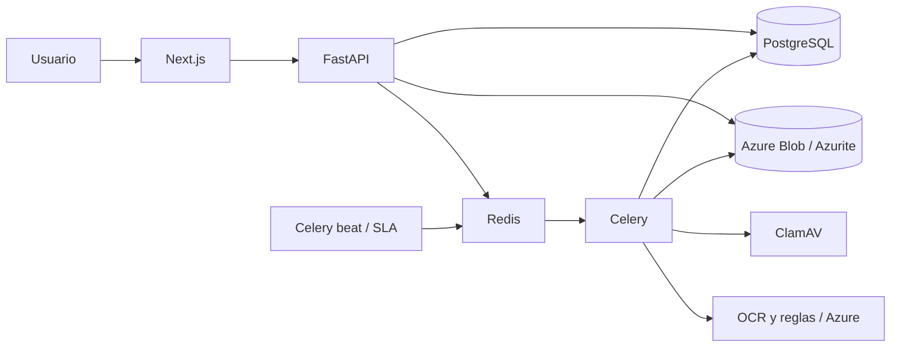

# Arquitectura

La interfaz Next.js consume la API FastAPI. PostgreSQL mantiene usuarios, permisos, expedientes, catálogos, tareas y trazabilidad. Azurite ofrece la API de Azure Blob en desarrollo para documentos; Redis transporta las tareas Celery. El worker analiza los documentos con ClamAV y procesa el texto mediante pdftotext/Tesseract o proveedores Azure configurados.

## Decisiones

- Separar peticiones HTTP y procesamiento documental evita bloquear la interfaz durante OCR.
- Guardar objetos fuera de PostgreSQL permite evolucionar hacia almacenamiento privado administrado.
- Los resultados automáticos requieren revisión humana. La extracción no equivale a aprobación crediticia.
- El catálogo inicial contiene configuración, no clientes ficticios. Los datos operativos se incorporan a través de los flujos del producto.
- Los adaptadores de IA permiten sustituir reglas locales por servicios externos; su configuración no demuestra que estén operativos.

La puesta en producción requiere observabilidad, reconciliación de tareas, pruebas de carga, política de retención, recuperación y evaluación formal de los proveedores. Consulte el código y sus tests para el alcance exacto implementado; este diagrama describe la separación prevista de componentes.
